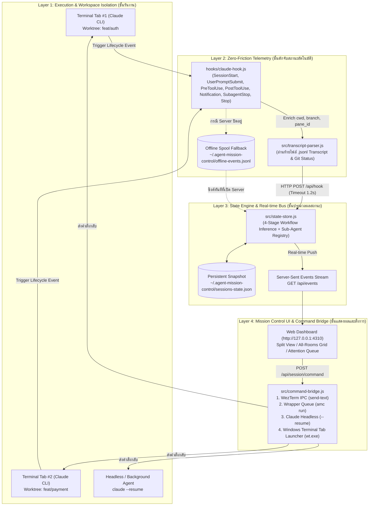
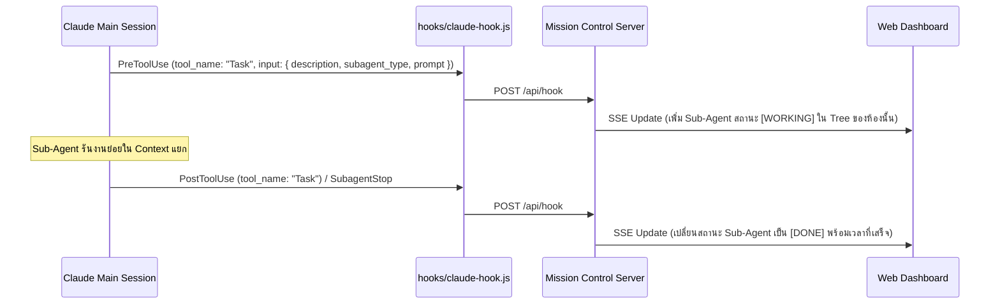

# 📐 สถาปัตยกรรมและการออกแบบระบบ (Architecture & System Design)

เอกสารนี้บันทึกแนวคิดการออกแบบและสถาปัตยกรรมทั้งหมดของ **Agent Mission Control (`amc`)** สำหรับใช้อ้างอิงและพัฒนาต่อยอดเมื่อย้ายเครื่องคอมพิวเตอร์

---

## 1. การวิเคราะห์ต้นตอของปัญหา (Root Cause Analysis)

ทำไมการเปิดใช้ Claude CLI หรือ Coding Agents หลายๆ Terminal Tabs ถึงกินพลังงานสมองมาก?

| ปัญหาเดิม (Raw Multi-Tab Terminal) | ผลกระทบต่อสมอง (Cognitive Load) | แนวทางแก้ใน Agent Mission Control |
| :--- | :--- | :--- |
| **1. ข้อมูลเป็น Raw Text Scrollback** | ต้องเลื่อนอ่านข้อความ 200–500 บรรทัดทุกครั้งที่สลับ Tab เพื่อดูว่าทำถึงไหนแล้ว | สกัด **Auto-TL;DR (2 บรรทัด)** และแปลงเป็น **4-Stage Workflow Bar** อัตโนมัติ |
| **2. Sub-Agents ซ่อนอยู่ใน Log** | เมื่อ Agent เรียก `Task` แตกงานย่อย เราไม่เห็นภาพรวมว่ามีตัวลูกกี่ตัว กำลังทำอะไร | ดักจับ Tool `Task` / `SubagentStop` แล้ววาดเป็น **Sub-Agent Hierarchy Tree** |
| **3. ระบบเป็นแบบ Pull-only** | คนต้องคอยคลิกไล่ดูทีละ Tab ว่ามี Tab ไหนติด Permission Prompt หรือรอกดยืนยัน | เปลี่ยนเป็น **Event-Driven Push** แยกห้องที่ติดปัญหาขึ้น **Attention Queue** ด้านบนสุด |
| **4. การสั่งการกระจัดกระจาย** | ต้องจำว่าฟีเจอร์ไหนอยู่หน้าต่างไหน Tab ที่เท่าไหร่เพื่อสลับไปพิมพ์ | รวมศูนย์ด้วย **Command Bridge** และปุ่มลัดเปิด/โฟกัส Terminal Tab ของห้องนั้นทันที |

---

## 2. โครงสร้างสถาปัตยกรรม 4 ชั้น (The 4-Layer Architecture)

---

## 3. กลไกการแปลงเหตุการณ์เป็น Workflow Stage อัตโนมัติ (Workflow Inference Engine)

ไฟล์ [`src/transcript-parser.js`](../src/transcript-parser.js) และ [`src/state-store.js`](../src/state-store.js) แปลงเหตุการณ์จาก Claude Code ให้เป็น 4 ขั้นตอนมาตรฐานโดยที่ผู้ใช้ไม่ต้องตั้งค่าเอง:

1. **Stage 0 — `1. Plan & Explore` (วางแผนและสำรวจโค้ด)**
   - ทริกเกอร์เมื่อเกิด `UserPromptSubmit` หรือมีการเรียก Tool สำรวจ: `Read`, `Glob`, `Grep`, `LS`, `WebSearch`, `WebFetch`, `TodoWrite`
2. **Stage 1 — `2. Implement & Code` (ลงมือเขียนและแก้ไขโค้ด)**
   - ทริกเกอร์เมื่อมีการเรียก Tool แก้ไขไฟล์: `Edit`, `MultiEdit`, `Write`, `NotebookEdit` หรือการแตก `Task` (Sub-agent)
   - ระบบจะบันทึกชื่อไฟล์ที่ถูกแก้ไขเข้า `modifiedFiles` ของห้องนั้นอัตโนมัติ
3. **Stage 2 — `3. Verify & Test` (รันทดสอบและตรวจสอบความถูกต้อง)**
   - ทริกเกอร์เมื่อเรียก `Bash` ที่มีคำสั่งตระกูลทดสอบ/ตรวจสอบ เช่น `test`, `jest`, `vitest`, `playwright`, `pytest`, `eslint`, `tsc`, `build`, `cargo test`
4. **Stage 3 — `4. Done / Ready` (เสร็จสิ้นรอบคำสั่ง)**
   - ทริกเกอร์เมื่อเกิด Hook `Stop` และสกัดข้อความสรุปสุดท้ายของ Assistant จากไฟล์ `transcript_path` มาแสดงในช่อง **Auto-TL;DR**

---

## 4. กลไกการติดตาม Sub-Agents (Sub-Agent Hierarchy Tracking)

เมื่อ Claude Code แตกงานย่อย (Sub-agent) มันจะทำงานผ่าน Tool ที่ชื่อว่า `Task` (หรือ `Agent`):

นอกจากนี้ หากไฟล์ `transcript_path` (`.jsonl`) มีข้อมูล `tool_use` และ `tool_result` ของ Sub-agent ตัว `parseTranscriptTail()` จะดึงผลลัพธ์สรุปของ Sub-agent มาเติมให้อัตโนมัติ

---

## 5. กลไกการส่งคำสั่งกลับไปที่แต่ละ Session (4 Command Bridge Transports)

ในไฟล์ [`src/command-bridge.js`](../src/command-bridge.js) ระบบรองรับการส่งคำสั่งจากหน้าเว็บกลับไปยัง Session เป้าหมาย 4 รูปแบบ:

1. **WezTerm Multiplexer IPC (`wezterm-ipc`)**:
   - เมื่อรัน Claude ในโปรแกรม WezTerm ตัวแปรสภาพแวดล้อม `WEZTERM_PANE` จะถูกส่งมากับ Hook อัตโนมัติ
   - เวลาพิมพ์สั่งในหน้าเว็บ ระบบจะรัน `wezterm cli send-text --pane-id <id> --no-paste "<ข้อความ>\r"` ซึ่งพิมพ์ข้อความและกด Enter ลงใน Tab นั้นให้ทันที
2. **CLI Wrapper Queue (`amc-wrapper`)**:
   - เมื่อเริ่มต้นรันด้วย `amc run --room "ชื่อห้อง" claude` ตัว Wrapper จะเชื่อมกับคิวคำสั่งของห้องนั้น
3. **Claude Headless Resume (`claude-headless-resume`)**:
   - ใช้คำสั่งมาตรฐานของ Claude CLI: `claude --resume <session_id> -p "<คำสั่ง>" --output-format stream-json`
   - เหมาะมากเมื่อห้องนั้นทำงานรอบแรกเสร็จแล้ว (`Done`) และคุณอยากสั่งงานต่อจากหน้า Dashboard เลยโดยไม่ต้องสลับหน้าต่างไปที่ Terminal
4. **Windows Terminal Tab Launcher (`wt.exe`)**:
   - กดปุ่ม **"🖥️ เปิดใน Windows Terminal Tab"** บนการ์ดห้องใดก็ได้ ระบบจะสั่ง `wt.exe -w 0 new-tab --title "<ชื่อห้อง>" -d "<โฟลเดอร์>"` เพื่อพาคุณไปที่โฟลเดอร์ของห้องนั้นทันที
